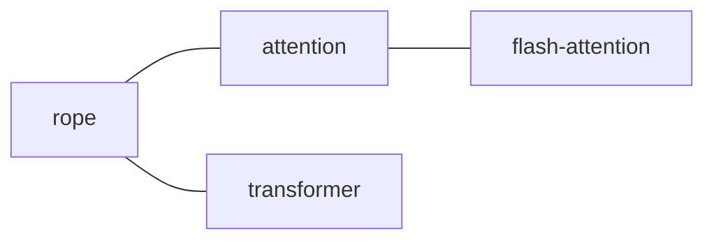

# Conversation → API patterns

Treat these as **recipes**, not scripts. The agent decides when to combine them. Every example is plain HTTP — pick whichever client your environment already has (`curl`, `fetch`, `requests`, etc.).

---

## Cross-platform note (Windows / macOS / Linux)

The bash + `curl` + `jq` snippets below are written for **macOS / Linux**. On **Windows**, translate them to whichever shell the user is in:

| What the bash example does | PowerShell equivalent | cmd.exe equivalent |
|---|---|---|
| `$TOKEN` env var | `$env:LLM_WIKI_API_TOKEN` | `%LLM_WIKI_API_TOKEN%` |
| URL-encode a string<br>`printf %s "$x" \| jq -sRr @uri` | `[System.Uri]::EscapeDataString($x)` | use a helper / `curl --data-urlencode` |
| `curl -s -H "Authorization: …"` | `curl.exe -s -H "Authorization: …"` (use `curl.exe` to avoid PowerShell's `curl` → `Invoke-WebRequest` alias) | `curl -s -H "Authorization: …"` |
| Backtick line-continuation `\` at end of line | backtick `` ` `` at end of line | `^` at end of line |

**Paths on Windows**:

- Prefer **forward slashes** in API request paths (`wiki/concepts/foo.md`).
- When using a Windows filesystem path as `{id}` (e.g. `C:/Users/me/wiki`), percent-encode it: the `/` **must** become `%2F`; a colon needs no encoding. `EscapeDataString` / `encodeURIComponent` / `jq @uri` do this correctly.
- If a path-as-id call returns 404 on Windows, fall back to `GET /api/v1/projects` and use the project's UUID — UUIDs are platform-agnostic and don't need encoding.

If you're calling from JavaScript / Python / Go / any other language with a real HTTP client (`fetch`, `requests`, `httpx`, `net/http`), platform doesn't matter — just `encodeURIComponent` or its equivalent and forget the shell quirks.

---

## "What does my wiki say about X?"

The single most common ask. Workflow:

1. `POST /api/v1/projects/current/search` with `{ query: X, topK: 5, includeContent: true }`
2. **Inspect `vectorHits` and `graphHits`** in the response to know how to read scores (see below).
3. If the top results are clearly above the rest (big gap in `score`), read those and synthesize. Otherwise read the top 3-5 and merge.
4. **Cite each `path` you used.** Quote snippets directly.
5. If nothing is found (empty `results` or a flat distribution with no clear winners), say so honestly. **Do not fabricate.**

```bash
curl -s -H "Authorization: Bearer $TOKEN" \
  -H 'Content-Type: application/json' \
  -d '{"query":"rope rotary position embedding","topK":5,"includeContent":true}' \
  $BASE/api/v1/projects/current/search
```

### How to read scores

The score's scale depends on **`vectorHits`**, not on `mode` (`mode` is `hybrid` whenever graph neighbours are included, even without vectors):

| Case | Typical `score` | What "good" looks like |
|---|---|---|
| `vectorHits: 0` | additive keyword score (sum of the keyword weights in `SKILL.md`), also when `mode` is `hybrid` | A clear gap (2×+) between top result and the rest. |
| `vectorHits > 0` | RRF; no numeric range is documented, so assume none | Relative order only. |

Results with `graphRelatedTo` are one-hop graph neighbours of the top hits, not text matches. Treat them as "related", not as answers.

**Don't apply a fixed threshold, and don't compare scores between modes or between responses with different `vectorHits`.** Rely on the relative gap among the non-graph hits. Use `vectorScore` (when present) for "how strong was the semantic match": a composite per-page value, not a raw cosine.

Answer template:

> Per `wiki/concepts/rope.md` (matched via hybrid, vectorScore=0.94), rotary position embedding works by rotating Q and K vectors by an angle proportional to position. Your wiki specifically mentions …

---

## "Read me the page about X"

User wants the full text, not a synthesis.

1. If the user named a slug-like identifier (`rope`, `flash-attention`), search first with `topK: 1` to disambiguate.
2. `GET /api/v1/projects/current/files/content?path=wiki/concepts/rope.md`
3. Render the content as markdown.

```bash
PATH_REL="wiki/concepts/rope.md"
# url-encode path component
ENCODED=$(printf %s "$PATH_REL" | jq -sRr @uri)
curl -s -H "Authorization: Bearer $TOKEN" \
  "$BASE/api/v1/projects/current/files/content?path=$ENCODED"
```

In JS:

```js
const encoded = encodeURIComponent("wiki/concepts/rope.md")
const r = await fetch(`${BASE}/api/v1/projects/current/files/content?path=${encoded}`, {
  headers: { Authorization: `Bearer ${TOKEN}` },
})
const { content } = await r.json()
```

---

## "What pages link to X?" / "Show me the neighborhood of X"

1. `GET /api/v1/projects/current/graph?limit=1000` — pull the graph (`limit` max 1000; if `hasMore: true`, page with `offset`).
2. Find `nodes[i].id === X` (or label substring match).
3. Filter `edges` for `source === X || target === X`. The other endpoint is a neighbor.

```bash
curl -s -H "Authorization: Bearer $TOKEN" "$BASE/api/v1/projects/current/graph?limit=1000"
```

`?q=rope` filters **nodes** by substring of `id` / `label` (case-insensitive) and returns only the edges between matching
nodes: it does **not** return the neighbours of `rope` unless their names also contain `rope`. Use it to find
the node, then steps 1-3 for the neighbourhood. With more than 1000 nodes, `edgeScope=filtered` returns, for each page of
nodes, the edges towards all filtered nodes. Pages with `type: query` never appear in the graph.

Render a small mermaid graph when the user wants a visual:



---

## "What's in my wiki?" / "Give me an overview"

Two angles:

**Structural overview** — file tree:

```bash
curl -s -H "Authorization: Bearer $TOKEN" \
  "$BASE/api/v1/projects/current/files?root=wiki&recursive=true&maxFiles=500"
```

Summarize the directory structure (`concepts/`, `entities/`, `sources/`…) and rough page counts per category. If the wiki has more entries than `maxFiles`, the call fails with **413**: raise `maxFiles` (up to 10000). On 0.6.13 each `path` is absolute (`//?/C:/...` on Windows): strip the project path before passing it to `files/content`.

**Topical overview** — read the curated index:

```bash
for path in wiki/index.md wiki/overview.md purpose.md; do
  encoded=$(printf %s "$path" | jq -sRr @uri)
  curl -s -H "Authorization: Bearer $TOKEN" \
    "$BASE/api/v1/projects/current/files/content?path=$encoded"
  echo
done
```

The user's `purpose.md` describes intent; `index.md` enumerates pages; `overview.md` is the AI-generated topical summary. Quote the relevant chunks.

---

## "I added new docs to the source folder — re-index"

0. Check `GET /api/v1/projects`: the target project should be the one with `current: true`. Ingest is queued by the desktop UI, only for the project **open in the UI** (unless "Watch all projects" is on), with Source Watch `enabled` + `autoIngest` and a usable LLM. If the project is not open, tell the user to open it first.
1. `POST /api/v1/projects/{id}/sources/rescan`
2. Read back `changedTasks`. Report:
   - "Detected N new / M modified / K deleted files."
   - List the first ~5 file paths so the user can verify.
3. Tell the user the **actual ingest** runs asynchronously in the desktop queue, and only under the conditions in step 0 — encourage them to open the Activity panel to confirm it started.

```bash
curl -s -X POST -H "Authorization: Bearer $TOKEN" \
  "$BASE/api/v1/projects/$PROJECT_ID/sources/rescan"
```

Often no rescan is needed: with the project open, the app's watcher picks up files written into `raw/sources/`.

If `changedTasks` is empty:

> No new changes since the app last looked. Each change is reported once, so files the watcher already saw are not listed again, even if they were not ingested. If you added files and nothing appears in the Activity panel, check that the project is open and `Settings → Source Watch` (`enabled`, `autoIngest`, filters: e.g. `.json` is excluded by default).

An **unchanged** source is never ingested again, whether by rescan or by re-queuing it in the UI: the ingest cache
matches the hash of the extracted text, and editing `schema.md` / `purpose.md` or switching model does not invalidate it
.

---

## "Find every page that mentions Y" (broad sweep)

Search is ranked (keyword + one-hop graph neighbours, plus vectors when embeddings are configured), covers only `wiki/**/*.md` (at most 10,000 files; past that it stops and the response does not say so) and is capped at 50 hits per call; graph neighbours take part of those 50. For **exhaustive** sweeps:

1. Run `POST .../search` with `topK: 50` and your term.
2. If the 50th result still has a non-trivial score (relative to the top), run again with a more specific query — the API will not return more than 50 in one call.
3. For **exact-string** sweeps where keyword tokenization mangles your phrase (e.g. CJK punctuation boundaries, code identifiers with underscores), walk every `wiki/*.md` via `files` + `files/content` and grep client-side. Slow but reliable.
4. Pure-semantic sweeps: set `topK: 50` and read `vectorScore` on each hit — pages without `vectorScore` matched only via keyword.

---

## "Search in my Reading project, not the current one"

When the user names a specific project rather than implying the active one.

1. List projects to resolve the name:

   ```bash
   curl -s -H "Authorization: Bearer $TOKEN" "$BASE/api/v1/projects"
   ```

   Returns:
   ```json
   {
     "projects": [
       {"id":"abc-…","name":"Research Notes","path":"/Users/me/wiki/research","current":true},
       {"id":"def-…","name":"Reading","path":"/Users/me/wiki/reading","current":false}
     ],
     "currentProject": {"id":"abc-…","name":"Research Notes","path":"/Users/me/wiki/research","current":true}
   }
   ```

   The list can hold several projects: match only the one the user named.

2. Match the user's spoken name. Case-insensitive substring on `name`:

   ```js
   const projects = (await (await fetch(`${BASE}/api/v1/projects`, {
     headers: { Authorization: `Bearer ${TOKEN}` },
   })).json()).projects
   const match = projects.filter(p => p.name.toLowerCase().includes("reading"))
   ```

3. Handle ambiguity:
   - **0 matches** → tell the user, list available names, ask which one. Don't silently fall back to `current` — that would answer the wrong question.
   - **1 match** → use its `id` in all subsequent calls for this conversation.
   - **2+ matches** → ask the user to disambiguate, showing both `name` + `path`.

4. Use the resolved id directly:

   ```bash
   PROJECT_ID="def-…"   # from step 2
   curl -s -H "Authorization: Bearer $TOKEN" \
     -H 'Content-Type: application/json' \
     -d '{"query":"narrative voice","topK":5}' \
     "$BASE/api/v1/projects/$PROJECT_ID/search"
   ```

5. Cache the `id` for the rest of the conversation. Don't re-list projects on every call. Only re-resolve if the user switches contexts ("now search my Research project instead").

You can also pass the project's filesystem path directly (URL-encoded) when the user references it that way:

```bash
PROJECT_PATH=$(printf %s "/Users/me/wiki/reading" | jq -sRr @uri)
curl -s -H "Authorization: Bearer $TOKEN" \
  "$BASE/api/v1/projects/$PROJECT_PATH/files?root=wiki"
```

---

## "Compare what my Research and Reading projects say about X"

User wants cross-project synthesis.

1. `GET /api/v1/projects` once → grab both ids.
2. Search each separately with the same query:

   ```bash
   for ID in research-id reading-id; do
     curl -s -H "Authorization: Bearer $TOKEN" \
       -H 'Content-Type: application/json' \
       -d '{"query":"narrative voice","topK":3,"includeContent":true}' \
       "$BASE/api/v1/projects/$ID/search"
   done
   ```

3. Diff / contrast the result sets. Cite **both** project name and page path: *"In Research Notes (`wiki/concepts/narrative.md`)… vs. in Reading (`wiki/concepts/voice.md`)…"*.

`current` only refers to the active project; for multi-project queries always pass explicit IDs.

---

## "Switch to project X" (mid-conversation)

User has been asking about the active project, then says "now check my Reading project for the same thing."

1. Re-resolve via `GET /api/v1/projects` (or use cached list if recent).
2. Replace your cached project id for the rest of the conversation.
3. **Confirm the switch in your reply once**: *"Switching to your Reading project…"*. Don't silently apply.
4. Keep the user's query — apply it to the new project.

The desktop UI's active project does **not** change just because you used a different `{id}`. Read calls on a non-current id do not affect the UI; write routes (rescan, reviews, `pages/write`, `pages/embed`, chat) still change that project's state.

---

## Anti-patterns

- **Don't `POST /chat`** — on 0.4.x it returns 501 (on 0.6.13 `/health` reports `agent.chat: true`). Use the desktop chat UI, or call your own LLM with the wiki content as context.
- **Don't paginate the file tree with maxFiles=1, maxFiles=2, …** — there's no offset/cursor, and exceeding `maxFiles` returns 413. Use a higher cap or filter by `root=`.
- **Don't edit `wiki/**` behind the app's back.** Direct filesystem edits to wiki pages skip merge, ingest cache and file history, and do not trigger ingest; make the change in the desktop app. Adding files to `raw/sources/**` from outside is fine: the app's watcher sees them and queues ingest under the conditions of the "re-index" recipe.
- **Don't include the token in URLs you echo / log / show.** Use headers in any output visible to the user.
- **Don't retry blindly on 429 / 503** — back off explicitly (1s / 2s respectively).
- **Don't shell out to a wrapper script.** The API is the contract. Direct `curl` / `fetch` is the interface.

---

## End-to-end transcript

User: *"What does my wiki say about flash attention? Show me the related concepts too."*

Agent (internally):

```bash
# 1. health + auth pre-flight
curl -s "$BASE/api/v1/health"
# → tokenSource=store, enabled=true, authConfigured=true ✓

# 2. search
curl -s -H "Authorization: Bearer $TOKEN" -H 'Content-Type: application/json' \
  -d '{"query":"flash attention","topK":5,"includeContent":true}' \
  "$BASE/api/v1/projects/current/search"

# 3. graph for the "flash-attention" neighborhood: q=flash only returns nodes whose id/label contains "flash",
#    so pull the graph and filter edges touching "flash-attention" client-side
curl -s -H "Authorization: Bearer $TOKEN" \
  "$BASE/api/v1/projects/current/graph?limit=1000"
```

Agent (to user):

> Looking in your active project. Search used keyword + vector signals (tokenHits=12, vectorHits=8, graphHits=2) — top hit `wiki/concepts/flash-attention.md` matched both (`vectorScore=0.91`).
>
> Your wiki explains FlashAttention as a memory-efficient exact attention implementation that tiles the QKV matrices to avoid materializing the full N×N attention map. Key claim: **2-4× speedup at long context on A100s** (per your wiki).
>
> Related concepts in your graph:
> - `wiki/concepts/attention.md` (parent)
> - `wiki/concepts/long-context.md` (sibling, both reachable from `flash-attention`)
> - `wiki/entities/tri-dao.md` (cited author)
>
> Want me to read any of these in full?
